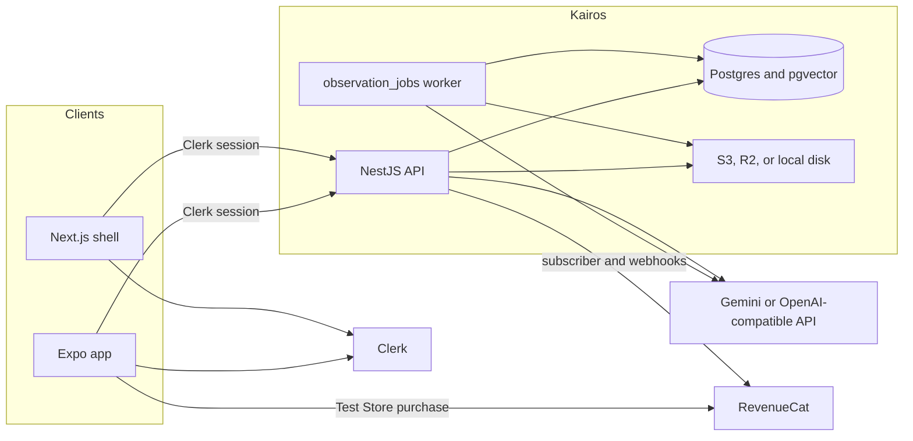
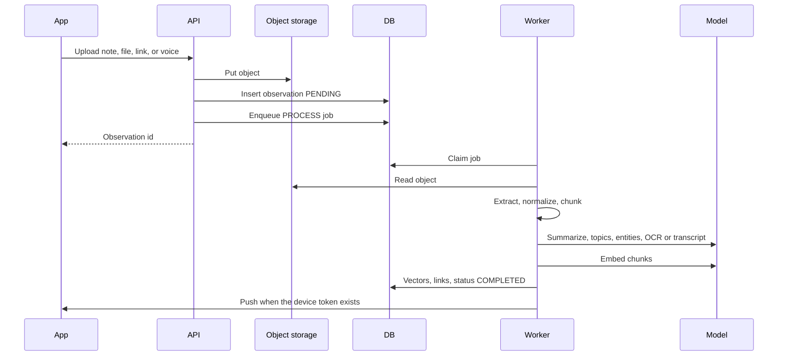
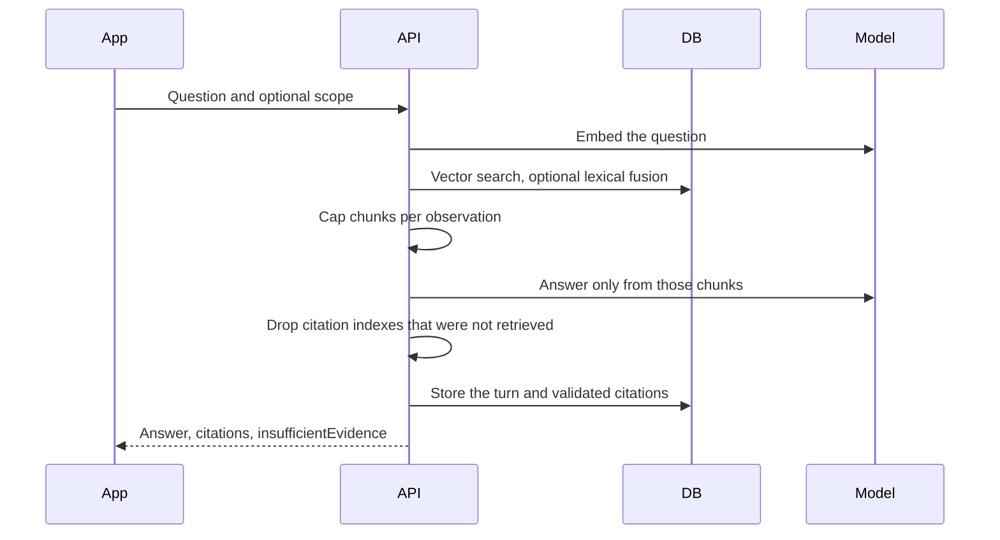
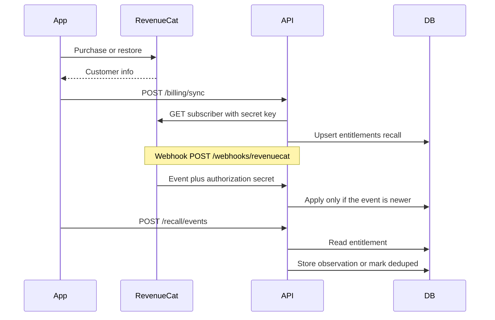

# Kairos — Architecture

Kairos is a mobile client, a NestJS API, and a Postgres database. Files live in object storage. Models and purchases are external services. The phone is untrusted for authorization and for Pro status.

## 1. System



| Piece | Role |
| --- | --- |
| `apps/mobile` | Today, Library, Capture, Ask, You, and Recall. This is the product. |
| `apps/web` | Clerk-gated Next.js shell. The main routes are placeholders. |
| `backend` | Auth, capture, processing, search, Ask, insights, progression, billing, and Recall. |
| Postgres | Users, observations, chunks and vectors, topics, entities, projects, conversations, jobs, entitlements, progression. |
| Object storage | Original uploads. Production requires S3 or R2. |
| RevenueCat | Sells Kairos Pro and is the source of truth for the `recall` entitlement. |
| Clerk | Signs the user in. The API never trusts a user id from the body. |

## 2. Backend modules

`AppModule` wires Prisma, auth, users, storage, observations, search, Ask, topics, entities, projects, entitlements, insights, notifications, progression, and Recall.

Work that must survive a restart goes into `observation_jobs` (`PROCESS`, `REINDEX`, `NOTIFY`). The worker claims a row with `SKIP LOCKED`, runs it, and records attempts. Rate-limit hits for Recall live in `rate_limit_events`, so a second instance shares one quota.

## 3. Capture path



Extraction depends on type:

- PDF and documents become text.
- Images go through OCR when an OCR provider is configured.
- Audio is transcribed.
- Notes and fetched URL text skip file parsing and enter the same normalize-and-index path.
- A URL fetch refuses private network addresses and stops after a byte cap.

Analysis can fail without discarding the text. Embeddings cannot. Production will not start with the local hash embedder, because those vectors are not real semantic search.

## 4. Ask path



Hybrid fusion is optional. The default path is pgvector cosine distance plus a per-observation cap so one long note cannot fill the context. Filters for topic, entity, and project are resolved to rows the caller owns before the query runs.

## 5. Recall and billing



The entitlement row is what Recall checks. `isPro` is stored, and `validUntil` is checked again on read. Stores recorded on the row include `app_store`, `play_store`, `stripe`, and `test_store`. The Test Store is the demo path. A Stripe purchase link is the fallback when a native package is missing.

Recall events become observations with source `RECALL`. Duplicate client event ids return `deduped`. The user can delete that slice with `DELETE /recall/data`.

## 6. Data model

The unit of memory is an **observation**: the captured file or text, its extracted body, and its chunks. There is no second “memory” table. Topics, entities, and projects point at observations.

```text
User
 ├── Observations
 │    ├── Chunks (text + vector)
 │    ├── Topics
 │    ├── Entities
 │    └── Project memberships
 ├── Conversations
 │    └── Messages (citations JSON)
 ├── Entitlement (feature RECALL)
 ├── Recall event receipts
 ├── Device tokens
 └── Progression (xp, streak, unlocks)
```

Important constraints:

| Constraint | Why |
| --- | --- |
| `users.clerkUserId` unique | One Kairos user per Clerk account. |
| `observations (userId, clientCaptureId)` unique | Upload retries do not duplicate. |
| `observation_chunks (observationId, chunkIndex)` unique | Reprocessing replaces a stable chunk list. |
| `entitlements (userId, feature)` unique | One Recall row per user. |
| `conversation_messages (conversationId, clientRequestId)` unique | Ask retries do not double-charge a turn. |
| `recall_event_receipts (userId, clientEventId)` unique | Screen events are idempotent. |
| `progression_events (progressionId, idempotencyKey)` unique | Streak and XP retries do not double-credit. |

Chunk embeddings are a pgvector column written with SQL. Prisma marks that field unsupported. Dimension follows `EMBEDDING_DIMENSIONS` and must match the configured embedding model.

## 7. Trust boundaries

| Boundary | Rule |
| --- | --- |
| Phone to API | Clerk proves identity. Body fields do not. |
| Phone to RevenueCat | The public SDK key can start a purchase. It cannot write `isPro`. |
| RevenueCat to API | Webhooks must present `REVENUECAT_WEBHOOK_AUTHORIZATION`. |
| API to models | Prompts and documents leave only toward the configured provider. Responses are schema-checked. |
| API to storage | Production will not fall back to local disk. |
| User to user | Queries include `userId`. A missing row and a forbidden row look the same where an id would leak. |

## 8. Runtime

Local Docker Compose starts:

- `pgvector/pgvector:pg16` on port 5432
- the API on port 3000
- the web shell on port 3001

The phone runs on the host and points `EXPO_PUBLIC_API_URL` at the machine. An Android emulator uses `http://10.0.2.2:3000` when the API is on that machine.

Hosted data uses Neon (`DATABASE_URL` pooled, `DIRECT_URL` for migrations). Object storage and the RevenueCat webhook are configured outside Compose.

## 9. What this architecture refuses

- Process-local capture queues.
- A client-supplied Pro flag.
- Local embeddings in production.
- Open CORS with credentials in production.
- Search over observations that have not finished processing.
- Model citations that were not in the retrieved chunk set.
